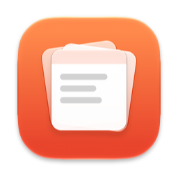
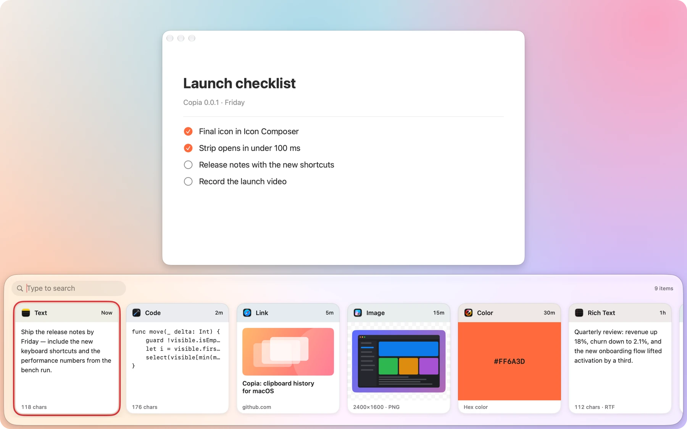
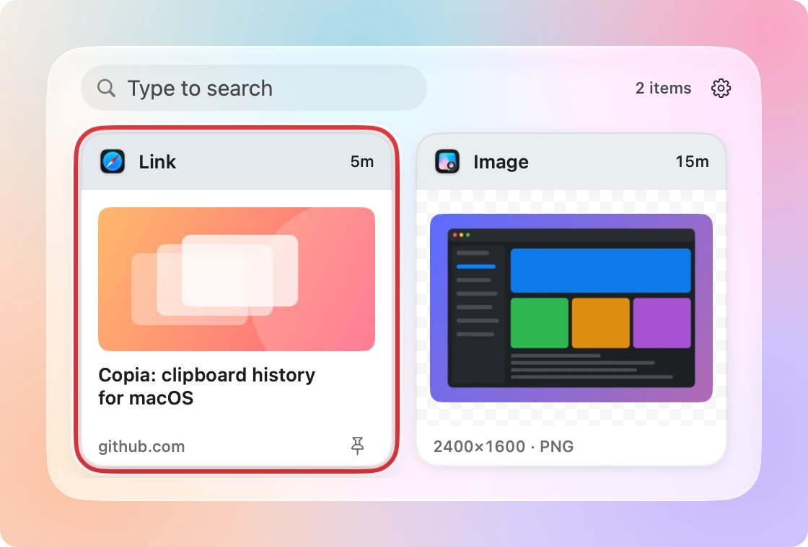

<div align="center">

<picture>
  <source media="(prefers-color-scheme: dark)" srcset=".github/media/icon-dark.png">
  
</picture>

# Copia

**Everything you copy, one keystroke away.<br/>A clipboard history for macOS 27.**

[](https://github.com/D0n9X1n/copia/releases/latest) [](https://github.com/D0n9X1n/copia/actions/workflows/ci.yml) [](wiki/Usage.md#install)

**[Download](https://github.com/D0n9X1n/copia/releases/latest)** · **[Documentation](wiki/Home.md)** · [简体中文](wiki/Home-zh-CN.md)

<sub>macOS 27 · Apple silicon · one dependency · inspired by Paste</sub>

</div>

<p align="center">
  <picture>
    <source media="(prefers-color-scheme: dark)" srcset=".github/media/hero-dark.webp">
    
  </picture>
  <br/>
  <sub><b>Press ⌘Y and it is all there.</b> A strip of glass cards slides up over the app you are in. Pick one and it pastes right where you were typing.</sub>
</p>

## Why Copia

- **⌘C is all it takes.** Text, rich text, images, links, files and colors land at the front of your history. Copy something again and it moves back to the front.
- **⌘Y brings it back.** The strip opens over whatever you are doing without taking focus from it, so the paste lands in the app you were using.
- **Fast enough to forget.** The strip opens in 79 ms (p95 93 ms) and idles at 0.05% CPU and 31 MB. CI fails any build that goes over budget.
- **Private by default.** Concealed copies and password managers are never stored, ⌘T pauses capture, and nothing leaves your Mac except a link's one-time preview request.
- **Yours, on disk.** History is one SQLite file plus thumbnails in Application Support. Deleting a card deletes its files.

## A closer look

<table>
  <tr>
    <td width="50%" valign="top">
      <picture>
        <source media="(prefers-color-scheme: dark)" srcset=".github/media/search-dark.webp">
        
      </picture>
      <br/><sub><b>Type to search</b>: the strip filters as you type and highlights every match.</sub>
    </td>
    <td width="50%" valign="top">
      <picture>
        <source media="(prefers-color-scheme: dark)" srcset=".github/media/previews-dark.webp">
        
      </picture>
      <br/><sub><b>Real previews</b>: links load their title and image once and keep them; images get a thumbnail.</sub>
    </td>
  </tr>
  <tr>
    <td width="50%" valign="top">
      <picture>
        <source media="(prefers-color-scheme: dark)" srcset=".github/media/quick-paste-dark.webp">
        
      </picture>
      <br/><sub><b>Quick paste</b>: hold <kbd>⌘</kbd> to see the numbers, press <kbd>⌘1</kbd> – <kbd>⌘9</kbd> to paste that card.</sub>
    </td>
    <td width="50%" valign="top">
      <picture>
        <source media="(prefers-color-scheme: dark)" srcset=".github/media/undo-dark.webp">
        
      </picture>
      <br/><sub><b>Delete, then undo</b>: <kbd>⌫</kbd> removes a card and <kbd>⌘Z</kbd> brings it back.</sub>
    </td>
  </tr>
</table>

<p align="center">
  <picture>
    <source media="(prefers-color-scheme: dark)" srcset=".github/media/windows-dark.webp">
    
  </picture>
  <br/>
  <sub><b>Small and settled.</b> A four-step welcome asks for the two permissions Copia needs; Settings holds history length, shortcuts and ignored apps.</sub>
</p>

## Get started

1. Download `Copia-0.0.1.zip` from the [latest release](https://github.com/D0n9X1n/copia/releases/latest), unzip it and move `Copia.app` to `/Applications`.
2. Open it. This build is signed but not notarized, so macOS blocks the first launch: open **System Settings → Privacy & Security** and click **Open Anyway** next to the message about Copia.
3. The welcome window asks for **Accessibility**, so Copia can send ⌘V to the app you were using, and **clipboard access**, so it can keep your history.

Then copy something and press <kbd>⌘Y</kbd>.

| Key | In the strip |
|---|---|
| <kbd>←</kbd> <kbd>→</kbd> | Select the previous or next card |
| <kbd>↩</kbd> or double-click | Paste into the app you were using |
| <kbd>⇧</kbd><kbd>↩</kbd> | Paste as plain text |
| <kbd>⌘1</kbd> – <kbd>⌘9</kbd> | Paste that card |
| <kbd>⌘C</kbd> | Copy the card without pasting |
| <kbd>⌫</kbd> · <kbd>⌘Z</kbd> | Delete the card · undo |
| Type | Search |
| <kbd>⎋</kbd> | Clear the search, then close |

<kbd>⌘Y</kbd> opens and closes the strip and <kbd>⌘T</kbd> pauses capture; change both in Settings → Shortcuts. See [Usage](wiki/Usage.md) for everything else.

## Light by design

`copia-bench` seeds 1,000 clips, 300 of them images, and CI fails the build when any budget is exceeded.

| | Budget | Measured |
|---|---|---|
| Idle CPU, strip hidden | < 0.1% | 0.05% |
| Idle memory | < 40 MB | 31 MB |
| Strip open, after scrolling through every card | < 120 MB | 34 MB, 92 MB after scrolling all 1,000 |
| ⌘Y to first frame, in process | p95 < 100 ms | p50 77–81 ms, p95 91–93 ms |

<sub>M3 Pro, macOS 27.2, release build, a 1512 pt strip. On this Mac's 60 Hz display the first presented frame arrives at p95 120–125 ms; presented-frame budgets are checked on a 120 Hz display. How it stays there: [Performance](wiki/Performance.md).</sub>

## Build from source

Copia builds with SwiftPM and the Xcode 27.2 toolchain:

```sh
export DEVELOPER_DIR=/Applications/Xcode.app/Contents/Developer
swift build && swift test
scripts/build-app.sh          # dist/Copia.app and dist/Copia-0.0.1.zip
```

The screenshots above are rendered from fixture data by `scripts/readme-media.sh`. See [Development](wiki/Development.md) for the rest.

## Documentation

[Usage](wiki/Usage.md) · [Architecture](wiki/Architecture.md) · [Performance](wiki/Performance.md) · [Development](wiki/Development.md), also in [简体中文](wiki/Home-zh-CN.md).

## Thanks, Paste

Copia is a small homage to [Paste](https://pasteapp.io), whose strip of cards at the bottom of the screen it follows. It is an independent project, not affiliated with Paste or its makers.
