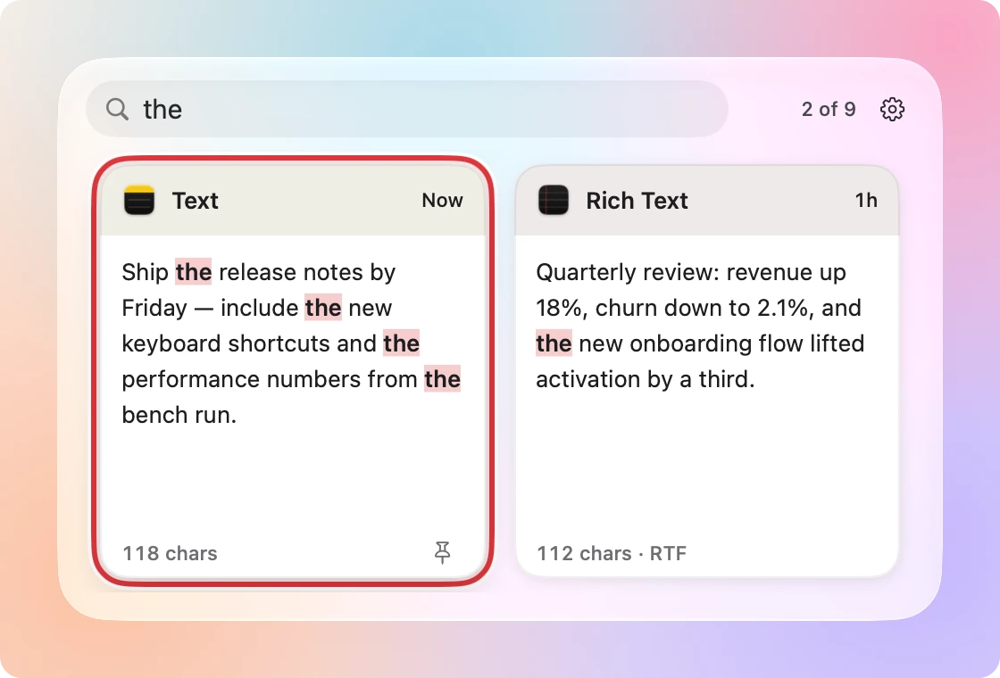
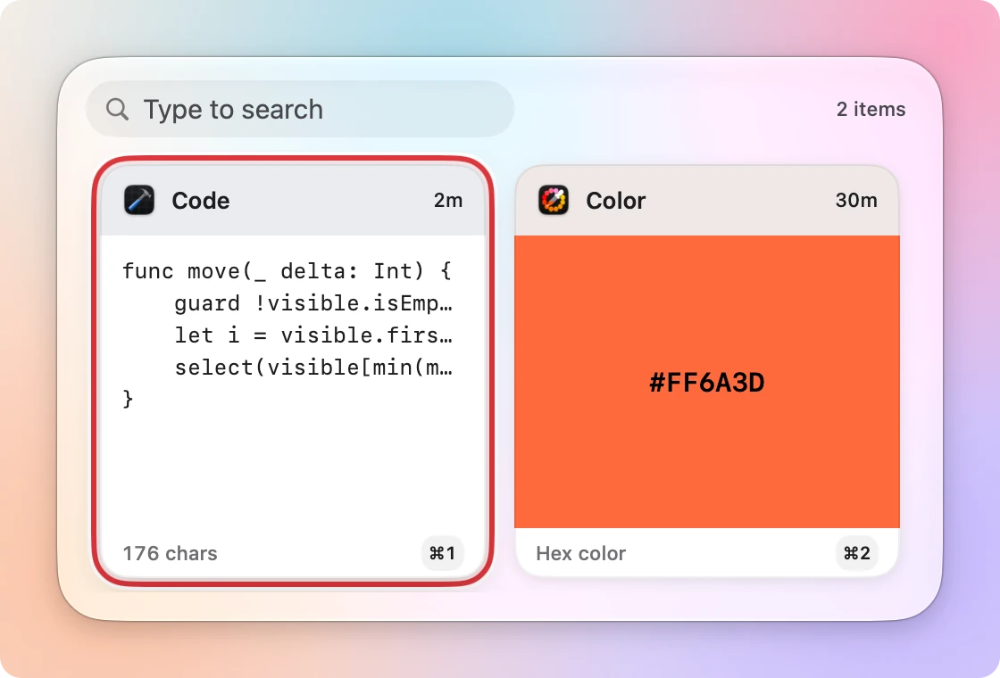
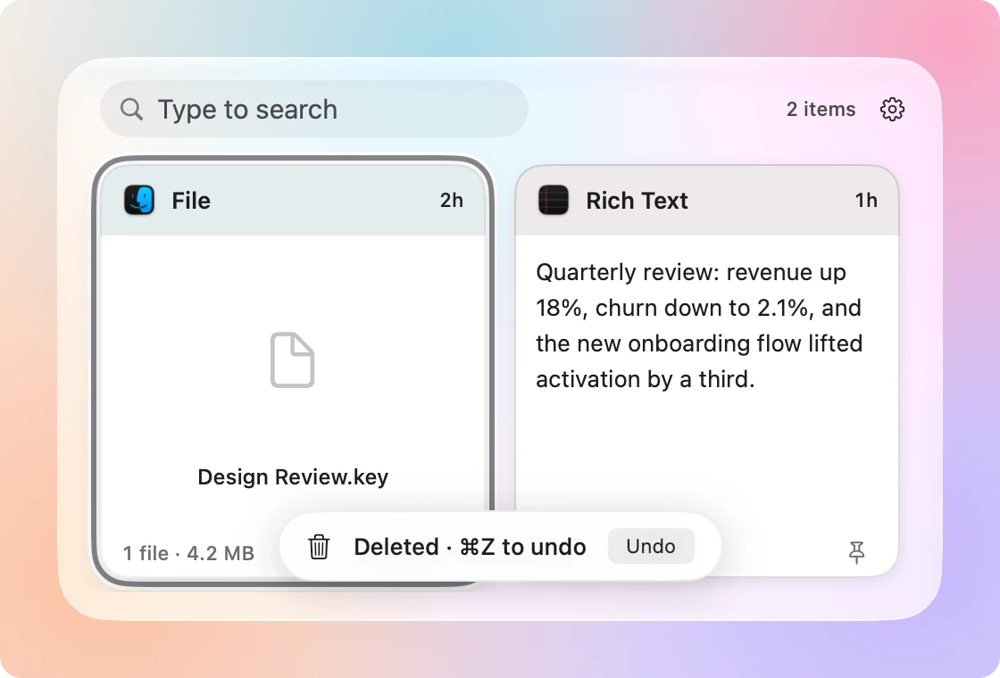
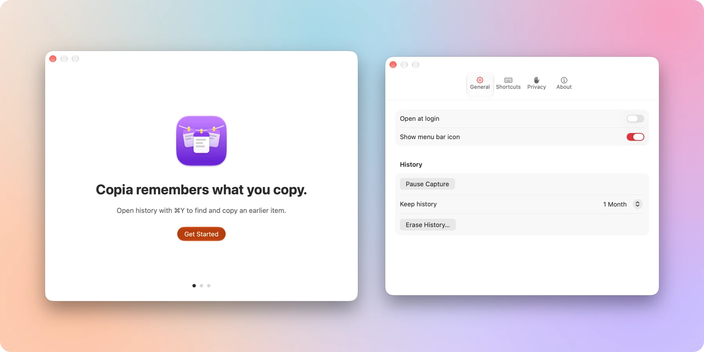

<div align="center">

<picture>
  <source media="(prefers-color-scheme: dark)" srcset=".github/media/icon-dark.png">
  
</picture>

# Copia

**Everything you copy, one keystroke away.<br/>A clipboard history for macOS 26 and later.**

[](https://github.com/D0n9X1n/copia/releases/latest) [](https://github.com/D0n9X1n/copia/actions/workflows/ci.yml) [](wiki/Usage.md#install)

**[Download](https://github.com/D0n9X1n/copia/releases/latest)** · **[Documentation](wiki/Home.md)** · [简体中文](wiki/Home-zh-CN.md)

<sub>macOS 26+ · Apple silicon and Intel · one dependency · inspired by Paste</sub>

</div>

<p align="center">
  <picture>
    <source media="(prefers-color-scheme: dark)" srcset=".github/media/hero-dark.webp">
    
  </picture>
  <br/>
  <sub><b>Press ⌘Y and it is all there.</b> A strip of glass cards slides up over the app you are in. Pick a card to copy it, then press ⌘V where you want it.</sub>
</p>

## Why Copia

- **⌘C is all it takes.** Text, rich text, images, links, files and colors appear newest first below your pins. Copy something again and it moves to the front of its group.
- **⌘Y brings it back.** The strip opens over whatever you are doing on the display under your pointer. Select a card on press; use Return to copy it and dismiss the strip.
- **Measured, not assumed.** Earlier local runs opened in 79 ms (p95 93 ms) and idled at 0.05% CPU and 31 MB. Earlier CI missed the historical <0.1% CPU limit and open-latency budget; fresh CI under the revised <0.15% CPU limit is required before release.
- **Private by default.** Concealed copies and password managers are never stored. Links make a one-time preview request. Settings → About checks for updates only when you ask; GitHub sees your IP address and the generic `Copia` user agent, not your version or clipboard history.
- **Yours, on disk.** History is one SQLite file plus thumbnails in Application Support. Deleting a card keeps a short-lived undo snapshot; any pending file cleanup is reported.

## A closer look

<table>
  <tr>
    <td width="50%" valign="top">
      <picture>
        <source media="(prefers-color-scheme: dark)" srcset=".github/media/search-dark.webp">
        
      </picture>
      <br/><sub><b>Type to search</b>: the strip filters as you type and highlights every match.</sub>
    </td>
    <td width="50%" valign="top">
      <picture>
        <source media="(prefers-color-scheme: dark)" srcset=".github/media/previews-dark.webp">
        
      </picture>
      <br/><sub><b>Real previews</b>: links load their title and image once and keep them; images get a thumbnail.</sub>
    </td>
  </tr>
  <tr>
    <td width="50%" valign="top">
      <picture>
        <source media="(prefers-color-scheme: dark)" srcset=".github/media/quick-paste-dark.webp">
        
      </picture>
      <br/><sub><b>Quick copy</b>: hold <kbd>⌘</kbd> to see the numbers, press <kbd>⌘1</kbd> – <kbd>⌘9</kbd> to copy that card and close.</sub>
    </td>
    <td width="50%" valign="top">
      <picture>
        <source media="(prefers-color-scheme: dark)" srcset=".github/media/undo-dark.webp">
        
      </picture>
      <br/><sub><b>Delete, then undo</b>: <kbd>⌫</kbd> removes a card and <kbd>⌘Z</kbd> brings it back.</sub>
    </td>
  </tr>
</table>

<p align="center">
  <picture>
    <source media="(prefers-color-scheme: dark)" srcset=".github/media/windows-dark.webp">
    
  </picture>
  <br/>
  <sub><b>Small and settled.</b> Clipboard access enables capture; no Accessibility permission is needed for picking a card. Settings holds history length, shortcuts and ignored apps.</sub>
</p>

## Get started

1. Download the universal `Copia-<version>.zip` from the [latest release](https://github.com/D0n9X1n/copia/releases/latest), unzip it and move `Copia.app` to `/Applications`. Both slices target macOS 26 or later. See **Verification** in that release’s notes for whether it ran on native Intel hardware or macOS 26.
2. Open it. This build is signed but not notarized, so macOS blocks the first launch: open **System Settings → Privacy & Security** and click **Open Anyway** next to the message about Copia.
3. Allow **clipboard access** for history. Copia writes your selection to the clipboard; it never types into another app. Press **⌘V** yourself.

Then copy something and press <kbd>⌘Y</kbd>.

| Key | In the strip |
|---|---|
| <kbd>←</kbd> <kbd>→</kbd> | Select the previous or next card |
| <kbd>↩</kbd> or double-click | Copy the selected or pointed card and close |
| <kbd>⇧</kbd><kbd>↩</kbd> | Copy as plain text and close |
| <kbd>⌘1</kbd> – <kbd>⌘9</kbd> | Copy that card and close |
| <kbd>⌘C</kbd> | Copy the primary card without closing |
| <kbd>⌫</kbd> · <kbd>⌘Z</kbd> | Delete selected results · undo the batch |
| <kbd>⌘A</kbd> · <kbd>⌘P</kbd> | Freeze the current filtered selection · pin/unpin the primary card |
| Type · <kbd>Tab</kbd> or <kbd>↓</kbd> | Edit Search · return to Results after composing |
| <kbd>⎋</kbd> | Clear the search, then close |

Pause Capture has no default shortcut. The menu bar icon is on by default; if you hide it, use the strip’s gear or reopen Copia to reach Settings. See [Usage](wiki/Usage.md) for everything else.

## Light by design

`copia-bench` seeds 1,000 clips, 300 of them images, and CI fails the build when any budget is exceeded.

| | Budget | Earlier local measurement |
|---|---|---|
| Idle CPU, strip hidden | < 0.15% | 0.05% |
| Idle memory | < 40 MB | 31 MB |
| Strip open, after scrolling through every card | < 120 MB | 34 MB, 92 MB after scrolling all 1,000 |
| ⌘Y to first frame, in process | p95 < 100 ms | p50 77–81 ms, p95 91–93 ms |

<sub>Earlier local runs on an M3 Pro, macOS 27.2, release build, a 1512 pt reference width (1496 pt panel). Later 60 Hz presented-frame p95 ranged from 126 to 165.5 ms; the first 120 Hz v0.0.2 candidate also missed scrolling and motion targets. CI has also missed idle CPU (0.208–0.214% against the historical <0.1% limit) and one in-process open p95 run (103 ms against <100 ms; the other was 74.7 ms), so these local results are not a release sign-off. Details: [Performance](wiki/Performance.md).</sub>

## Build from source

Copia builds with SwiftPM and the Xcode 27.2 toolchain:

```sh
export DEVELOPER_DIR=/Applications/Xcode.app/Contents/Developer
swift build && swift test
scripts/build-app.sh          # dist/Copia.app and the ZIP named for VERSION
```

The screenshots above are rendered from fixture data by `scripts/readme-media.sh`. See [Development](wiki/Development.md) for the rest.

## Documentation

[Usage](wiki/Usage.md) · [Architecture](wiki/Architecture.md) · [Performance](wiki/Performance.md) · [Development](wiki/Development.md), also in [简体中文](wiki/Home-zh-CN.md).

## Thanks, Paste

Copia is a small homage to [Paste](https://pasteapp.io), whose strip of cards at the bottom of the screen it follows. It is an independent project, not affiliated with Paste or its makers.
