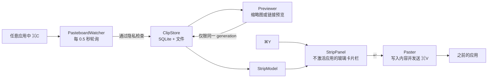

# 架构

[English](Architecture)

### 模块

| 模块 | 职责 |
|---|---|
| `CopiaCore` | 纯规则：卡片类型、捕获判断、去重标识、来源判定、保留期限 |
| `CopiaStore` | `ClipStore` actor：SQLite（WAL）加三元组 FTS5 索引，以及 `blobs/`、`thumbs/` 和 `trash/` |
| `CopiaSystem` | 与 macOS 的边界：`PasteboardWatcher`、`Paster`、`Previewer`、权限 |
| `CopiaUI` | 卡片栏（`StripModel`、`StripView`、`StripPanel`、`ClipCard`）、设置、引导、菜单栏 |
| `CopiaApp` | `AppController` 负责连接各部分；`SelfTest` 在每个显示器上驱动卡片栏 |
| `Copia`、`copia-render`、`copia-bench` | 应用、设计评审渲染器和基准测试 |

### 数据流

### 捕获

`PasteboardWatcher` 每 0.5 秒检查一次 `changeCount`，计时器容差为 0.1 秒。发生变化时，它先读取类型列表。任何隐藏、临时或密码管理器类型都会在读取内容之前终止捕获。随后它检查自上次检查以来位于前台的所有应用，因此在被忽略的应用中复制后迅速切换，仍会被跳过。只读取会保存的类型：文本、RTF、HTML、PNG、TIFF、文件 URL 和 URL。Copia 自己写入的内容带有 `app.copia.marker`，会被跳过。

去重标识是对有序剪贴板项计算的 SHA-256。每项内的表示按类型排序，每个字段都带长度前缀，因此项的边界也计入标识。再次复制同一内容会把已有记录移到最前面。

### 存储、删除与撤销

`ClipStore` 串行处理变更。删除先把原始内容和已保存的缩略图复制到以令牌命名的撤销快照，再提交记录及 FTS 条目的删除；恢复先把完整快照复制回原位置，再写入记录。数据库结果确认前始终保留原文件，因此失败时不需要把唯一副本移回。撤销令牌在三秒后、被新撤销替换、关闭、清除、重新启动或重新复制时失效，即使快照文件暂时无法移除。

已提交的操作可能留下等待清理的冗余文件。卡片栏和设置会持续显示警告，已有的关闭、每小时和启动清理会重试。只要还有文件，清除历史就会报告错误。如果数据库结果无法确认，Copia 会保留所有副本、暂停捕获并阻止存储操作，直到重新启动。启动清理会删除无归属文件及确认缺少内容的记录；目录不可读时停止破坏性清理。

每条记录都有一个 `generation`，每次插入和恢复时递增。只有 generation 仍然一致时才会保存预览，因此迟到的预览永远不会写到已删除或重新复制的卡片上。撤销或重新启动后仍处于等待状态的卡片会重新获取预览。已完成的预览除标题更新外不可变；撤销保留其状态和文件，不会重新获取已完成的链接。快照缺少必需文件时恢复失败，但不消耗撤销令牌。

### 卡片栏

`StripPanel` 是一个位于状态栏层级、带 `.nonactivatingPanel` 的无边框 `NSPanel`。它可以成为键窗口，因此输入会进入搜索框，但 Copia 永远不会成为活跃应用。实色卡片后面只有一层 SwiftUI `glassEffect` 背景。面板及其宿主视图只创建一次。卡片栏隐藏时，会释放卡片视图和缩略图缓存。
