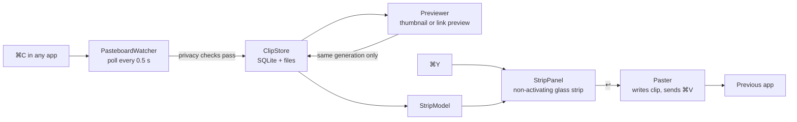

# Architecture

[简体中文](Architecture-zh-CN)

### Modules

| Module | Job |
|---|---|
| `CopiaCore` | Pure rules: clip kinds, capture decisions, dedup identity, source attribution, retention |
| `CopiaStore` | `ClipStore` actor: SQLite (WAL) with a trigram FTS5 index, plus `blobs/`, `thumbs/` and `trash/` |
| `CopiaSystem` | macOS edges: `PasteboardWatcher`, `Paster`, `Previewer`, permissions |
| `CopiaUI` | The strip (`StripModel`, `StripView`, `StripPanel`, `ClipCard`), Settings, onboarding, menu bar |
| `CopiaApp` | `AppController` wires everything together; `SelfTest` drives the strip on every display |
| `Copia`, `copia-render`, `copia-bench` | The app, the design-review renderer and the benchmark |

### Data flow

### Capture

`PasteboardWatcher` checks `changeCount` every 0.5 s with 0.1 s timer tolerance. On a change it reads the type list first. Any concealed, transient or password-manager type stops the capture before content is read. It then checks every app that was in front since the previous check, so a copy made in an ignored app and followed by a quick switch is still skipped. Only stored types are read: text, RTF, HTML, PNG, TIFF, file URLs and URLs. Copia's own writes carry `app.copia.marker` and are skipped.

The dedup identity is a SHA-256 over the ordered pasteboard items. Each item's representations are sorted by type and every field is length-prefixed, so item boundaries matter. Copying the same content again moves the existing row to the front.

### Storage, delete and undo

`ClipStore` is an actor, so rows and files change together. Delete removes the row and its FTS entry in one transaction, then moves the blob and thumbnail to `trash/`. ⌘Z restores them. Closing the strip, erasing history and launching all empty `trash/`. A launch sweep removes files without rows and rows without blobs.

Each row has a `generation` that increases on every insert and restore. A preview is saved only if its generation still matches, so a late preview never lands on a deleted or recopied clip. Clips still pending after an undo or relaunch are fetched again.

### The strip

`StripPanel` is a borderless `NSPanel` with `.nonactivatingPanel` at status-bar level. It can become key, so typing reaches the search field, but Copia never becomes the active app. One SwiftUI `glassEffect` backdrop sits behind solid cards. The panel and its hosting view are created once. When the strip hides, the card views and the thumbnail cache are released.
